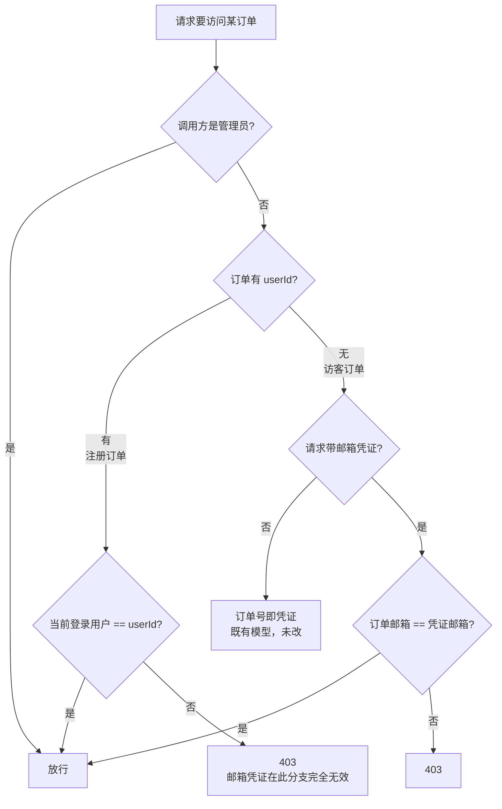
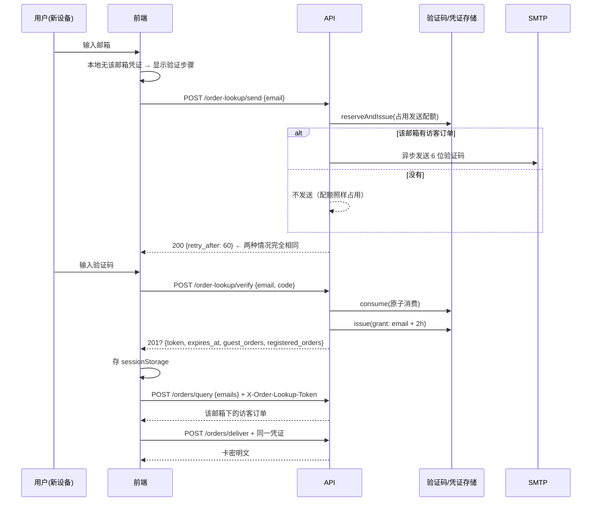

# 访客订单找回（邮箱验证码）

> 目标：用户换了设备、清了浏览器、丢了订单号，仍能凭「能收到该邮箱的信」找回自己的订单与卡密。
> 前提：邮箱验证通过 ≙ 证明控制该邮箱，但**不等于**登录，也**不等于**能看任何其他订单。
>
> 邮件本身的送达保障（服务商选型、SPF/DKIM/DMARC、多通道路由、重试与失败分类）见
> [email-delivery.md](email-delivery.md)。本文只管「验证码与授权」这一层。

## 一、已拍板的三个边界

| 问题 | 决定 | 落地位置 |
|---|---|---|
| 验证后能看哪些订单 | **只返回 `user_id IS NULL` 的访客订单**。该邮箱若还有注册账号的订单，只返回数量提示「另有 N 笔请登录查看」，不返回任何内容 | `OrderRepository#findGuestOrdersByEmail` + `VerifyResult.registeredOrders` |
| 是否允许领取/导出卡密 | **允许**，验证后可看明文、可下载 txt | `DeliverServiceImpl#deliverOrders/exportCardKeys` |
| 凭证有效期 | **2 小时**，同一邮箱最多并存 3 张（多设备），全站上限 10000 | `mail.verification.grant-ttl-seconds` |

## 二、授权模型：从两层扩到三层

改动前 `OrderAccessGuard` 只有两层，注释里就写着「跨设备邮箱查单需邮箱验证码，尚未实现」。现在是三层：



三条关键性质：

1. **注册订单永远不接受邮箱凭证。** `assertAccess` 的注册分支里根本不读 `lookupToken`。即使凭证邮箱与订单邮箱相同也拒绝——这正是验收要求「注册订单继续要求登录本人账号」的唯一落点，`GuestOrderLookupIntegrationTest#verifiedEmailUnlocksGuestOrdersOnly` 对此有断言。
2. **`assertSensitiveAccess` 的签名没有变。** 它只接受 `(order, sessionToken)`，物理上拿不到凭证，所以提交 TXID、重新支付这两条路径**不可能**被顺带放开。这不是靠自觉，是靠方法签名。
3. **访客订单的既有模型没动。** 不知道凭证、只知道订单号的人，行为和改动前完全一致。本次只做加法。

## 三、流程



## 四、防枚举：四条同时成立才算成立

「避免泄露邮箱是否有订单」不是加一句统一文案就够的，必须三个可观测量都对齐：

1. **响应体一致**：`sendCode` 只返回 `{retry_after}`，没有 `sent: true/false`。
2. **配额消耗一致**：该邮箱没有访客订单时，仍然走一次 `reserveAndIssue(email, null, ...)` 占用配额，只是不签发验证码。否则「第二次点击会不会被限流」就成了探测信号。
3. **耗时一致**：发信是 `@Async` 的，SMTP 握手时间不计入响应。
4. **失败原因不区分**：验证码不存在、已过期、码不对，统一返回 `EMAIL_CODE_INVALID` + 同一句话。

发信只在该邮箱确有访客订单时执行，这不构成泄露——邮件发到被查询的邮箱，攻击者读不到。反过来说，如果对任意邮箱都发信，本站 SMTP 就成了免费发信通道。

## 五、限流矩阵

| 维度 | scope | 窗口 | 全局 | 单维度 | 目的 |
|---|---|---|---|---|---|
| 发送 / IP | `email-code-send` | 1h | 200 | 8 | 挡住单机换邮箱刷信 |
| 发送 / 邮箱 | `email-code-send-email` | 1h | 200 | 5 | 挡住换 IP 刷同一邮箱 |
| 验证 / IP | `email-code-verify` | 10min | 300 | 12 | 挡住分布式猜码 |
| 验证 / 邮箱 | `email-code-verify-email` | 10min | 60 | 10 | 配合单码 5 次上限 |
| 单码尝试 | `max-attempts` | 生命周期 | — | 5 | 超限即销毁，必须重新获取 |

另有 `daily-per-email=10` 作为日上限。单码 5 次 + 10 分钟窗口，使「猜中 6 位数字」在概率上不可行（10^6 × 需时）。

**注意**：`maxAttempts` 的判定在比对之前。所以「错 4 次后第 5 次猜对」也会被拒——否则次数限制形同虚设。

## 六、并发消费的保证

`EmailVerificationCodeStore#consume` 走 `ConcurrentHashMap#compute`，对同一邮箱键串行执行；成功路径返回 `null` 直接删除条目。叠加 `AtomicBoolean` 的 CAS 作为第二道保险。

`EmailVerificationCodeStoreTest#concurrentConsumeSucceedsExactlyOnce` 用 12 个线程同时提交同一个正确验证码，断言成功次数恰好为 1。这条测试是验收重点「同一验证码并发提交，只能消费成功一次」的直接证据。

> 本实现把验证码与凭证放在**内存**。项目是单实例部署（docker-compose 无 replicas），进程重启后用户重收一次验证码即可，代价可接受。**若将来改为多实例，这两处必须换成 Redis 并保留同样的原子语义，否则并发唯一性会失效。**

## 七、配置

```yaml
mail:
  enabled: ${MAIL_ENABLED:false}          # 默认关闭：host/password 默认仍是占位符
  verification:
    enabled: ${MAIL_VERIFICATION_ENABLED:true}
    code-length: 6
    code-ttl-seconds: 600                 # 验证码 10 分钟
    resend-interval-seconds: 60           # 同邮箱重发间隔
    max-attempts: 5                       # 单码最大试错次数
    grant-ttl-seconds: 7200               # 凭证 2 小时
    daily-per-email: 10
    max-grants-per-email: 3
    max-grants: 10000
    max-orders-per-lookup: 100
```

`MailAvailability#isAvailable()` = `mail.enabled` 打开 **且** `spring.mail.host` / `spring.mail.password` 都不是占位符。

**本次修正了一个既有缺陷**：`EmailServiceImpl` 原来是 `@Value("${mail.enabled:false}")`，而 `application.yml` 是 `${MAIL_ENABLED:true}`，实际默认 true，导致「不填 SMTP」的部署会在每次发货时去连 `mail.example.com` 并失败。现在两层判定收敛到 `MailAvailability`，yml 默认改为 `false`，`README`、`.env.example` 已同步。

前端入口开关来自 `GET /site/config` 的 `email_verification_enabled`，与后端 `OrderLookupService#isAvailable()` 同源，避免前后端状态漂移。直接调接口时后端仍会返回 `EMAIL_VERIFICATION_UNAVAILABLE`。

## 八、明确不放宽的操作

| 操作 | 变更 | 说明 |
|---|---|---|
| `POST /orders/{id}/txid-verify` | 不变 | 会产生「认领链上交易」的副作用 |
| `POST /orders/{id}/repay` | 不变 | 会重建支付链接并冲击网关 |
| `POST /orders/{id}/refresh` | 不变 | 会主动向支付网关发起查询 |
| 任何注册订单的查询/领取/导出 | 不变 | 必须登录本人 |
| `POST /orders/query` 无凭证路径 | 不变 | 仍只返回同会话访客订单或本人订单 |
| `/admin/**` | 不变 | — |

`GuestOrderLookupIntegrationTest#sensitiveActionsIgnoreTheLookupGrant` 用 MockMvc 带 `X-Order-Lookup-Token` 直接打 repay 与 txid-verify，断言两者仍是 403。

## 九、上线影响

- **行为变化**：`MAIL_ENABLED` 未显式设置时，邮件从「默认开（但一定失败）」变为「默认关」。生产若已配置 `MAIL_ENABLED=true` 且填了真实主机/口令，行为不变。
- **无数据库变更**：不需要新表、不需要迁移、`ddl-auto: update` 不会产生任何 DDL。
- **无新依赖**：沿用 `spring-boot-starter-mail` 与既有 Redisson 限流实例。
- **新接口**：`POST /order-lookup/send`、`POST /order-lookup/verify`、`POST /order-lookup/revoke`，均在 `SecurityConfig` 中 `permitAll`。

## 十、验收对照

> 下列断言已于 2026-11-16 用 Temurin JDK 22.0.2 + Maven 3.9.16 实测：
> `mvn test` → **Tests run: 177, Failures: 0, Errors: 0, Skipped: 120**（跳过的是需要 Redis / PostgreSQL 外部服务的既有用例）。
> 其中本次新增 21 个用例（存储层 14 + 集成 7）。

| 验收重点 | 验证方式 |
|---|---|
| 换设备后可以找回该邮箱的访客订单 | `GuestOrderLookupIntegrationTest#verifiedEmailUnlocksGuestOrdersOnly` 跑通「发码→验证→查单→领卡」全链路 |
| 同一验证码并发提交只能成功一次 | `EmailVerificationCodeStoreTest#concurrentConsumeSucceedsExactlyOnce`（12 线程，成功数 == 1） |
| 不能修改请求邮箱查询他人订单 | `#requestEmailCannotBeSwappedForAnotherOne`：换邮箱 → 403；大小写不同 → 正常 |
| 注册订单/TXID/重新支付不会被顺带放开 | `#verifiedEmailUnlocksGuestOrdersOnly`（注册订单 403）+ `#sensitiveActionsIgnoreTheLookupGrant` |
| 邮件未配置时入口关闭并明确提示 | `#entryIsClosedWhenVerificationIsSwitchedOff` + 前端 `order.verify.disabledTitle/disabledDesc` |

手工验收建议顺序：

1. 关闭 SMTP（`MAIL_ENABLED=false`）→ 打开 `/order/query` 输入邮箱 → 应显示「邮箱查单未开启」，且不发出任何请求。
2. 配好 SMTP → 用一笔访客订单的邮箱查询 → 应出现验证面板。
3. 输入**没有订单**的邮箱 → 收不到信，但界面提示与第 2 步完全一致（不提示「查无此邮箱」）。
4. 输错验证码 5 次 → 提示「错误次数过多，请重新获取」；再点发送 → 需等重发倒计时。
5. 验证成功后 → 能看到该邮箱的访客订单与卡密，能下载 txt；若该邮箱还有注册订单，顶部出现「另有 N 笔请登录查看」。
6. 同一浏览器换一个邮箱查询 → 应先要求重新验证，而不是直接返回上一个邮箱的订单。

## 十一、已知风险

1. **邮箱被攻破即卡密被取走。** 这是邮箱找回机制的固有代价。收窄手段只有：2 小时有效期、每日 10 次上限、`log.info` 记录验证 IP 与邮箱掩码供事后排查。若要更强，需要第二因子（如订单号后 8 位）——本次未做，因为用户明确要的是「换设备也能找回」。
2. **内存存储，重启即失。** 单实例可接受；多实例部署前必须迁移到 Redis。
3. **邮箱大小写与首尾空格已在服务端规范化**（`trim + toLowerCase`），与仓储层 `lower(o.email)` 一致。若历史数据里存在 `A@x.com` 与 `a@x.com` 两条不同记录，会被合并视为同一邮箱——这是期望行为，但请在迁移前确认没有依赖大小写区分的逻辑。
4. **凭证不绑定 IP / UA。** 换网络、换浏览器的场景正是本功能要解决的，绑 IP 会把主要用例打死。代价是凭证被截获后可在别处复用，靠 2 小时有效期控制窗口。

## 十二、测试环境的一处必要修补

`apps/api/src/test/resources/application.yml` 会覆盖 `src/main` 的同名文件，而它原本没有 `spring.mail.host`。Spring Boot 仅在 `spring.mail.host` 存在时才创建 `JavaMailSender`，而 `EmailServiceImpl` 构造依赖它 —— 于是裸 `@SpringBootTest` 的 `SimpleCardApplicationTests#contextLoads` 一直启动失败。

其他集成测试因为都在注解里显式写了 `spring.mail.host=localhost` 才绕开。本次在该文件补上 `spring.mail.host: localhost`，`mail.enabled` 仍为 false、`MailAvailability` 判定为不可用，不改变任何业务行为，只是让 `mvn test` 整体变绿。

## 十三、本地手工验收（2026-11-16 实测通过）

自动化测试覆盖不了「真实发信 + 真实 HTTP + 换设备」这条链路，下面是可照抄的本地复现步骤。

### 1. 造数

```bash
psql -h 127.0.0.1 -U postgres -d simplecard -f docs/sql/guest-order-lookup-testdata.sql
```

脚本可重复执行，造出四笔订单：`buyer@test.local` 的访客单（目标）、`other@test.local` 的访客单（越权对象）、`123@qq.com` 的访客单与注册单（同邮箱双身份）。

### 2. 起本地收信服务

不需要真实邮箱，Mailpit 会接住所有外发邮件并提供 Web 界面：

```bash
docker run -d --name simplecard-mailpit -p 127.0.0.1:1025:1025 -p 127.0.0.1:8025:8025 axllent/mailpit:v1.21
```

收件箱：<http://localhost:8025>　取信 API：`GET /api/v1/messages`

### 3. 启动后端

```bash
cd apps/api
DB_URL="jdbc:postgresql://127.0.0.1:5432/simplecard" \
MAIL_ENABLED=true MAIL_HOST=127.0.0.1 MAIL_PORT=1025 \
MAIL_USERNAME=dev@test.local MAIL_PASSWORD=devpass \
mvn spring-boot:run \
  --server.port=8084 \
  -Dspring-boot.run.arguments="--spring.mail.properties.mail.smtp.ssl.enable=false --spring.mail.properties.mail.smtp.auth=false"
```

**必须显式关闭 `mail.smtp.ssl.enable`。** `application.yml` 为 465 端口预设了 `ssl.enable=true` 与 `auth=true`，连明文 1025 会直接报 `Could not connect to SMTP host`，而错误信息不会提示是 SSL 的问题，很容易误判成网络或防火墙。真实生产用 465/994 时保持默认即可。

端口用 8084 而不是默认 8083，是为了不打断本机已在运行的开发实例。

### 4. 七条断言

```bash
API=http://localhost:8084/api

# ① 入口开关（需 MAIL_ENABLED=true 且 host/password 非占位符才为 true）
curl -s $API/site/config | grep -o '"email_verification_enabled":[a-z]*'

# ② 发码：无论该邮箱有无订单，响应都是 {"retry_after":60}
curl -s -X POST $API/order-lookup/send -H 'Content-Type: application/json' -d '{"email":"buyer@test.local"}'

# ③ 从 http://localhost:8025 读出 6 位码后验证，拿 token
curl -s -X POST $API/order-lookup/verify -H 'Content-Type: application/json' \
  -d '{"email":"buyer@test.local","code":"<验证码>"}'

# ④ 换设备查询：只带邮箱 + 凭证，不带任何会话
curl -s -X POST $API/orders/query -H 'Content-Type: application/json' \
  -H "X-Order-Lookup-Token: <token>" -d '{"emails":["buyer@test.local"]}'

# ⑤ 领卡密 / 导出
curl -s -X POST $API/orders/deliver -H 'Content-Type: application/json' \
  -H "X-Order-Lookup-Token: <token>" -d '{"order_ids":["11111111-1111-4111-8111-111111111111"]}'
curl -s "$API/orders/11111111-1111-4111-8111-111111111111/export" -H "X-Order-Lookup-Token: <token>"

# ⑥ 越权：换邮箱 / 换别人的订单号 / 打注册订单，全部应 403
curl -s -X POST $API/orders/deliver -H 'Content-Type: application/json' \
  -H "X-Order-Lookup-Token: <token>" -d '{"order_ids":["33333333-3333-4333-8333-333333333333"]}'
curl -s -X POST $API/orders/deliver -H 'Content-Type: application/json' \
  -H "X-Order-Lookup-Token: <token>" -d '{"order_ids":["44444444-4444-4444-8444-444444444444"]}'

# ⑦ 敏感操作不被放宽：仍应是「请使用原下单账号」
curl -s -X POST $API/orders/11111111-1111-4111-8111-111111111111/repay \
  -H 'Content-Type: application/json' -H "X-Order-Lookup-Token: <token>" -d '{}'
```

实测结果：①true ②`retry_after:60` ③`guest_orders:1` ④返回 1 单 ⑤卡密 `TEST-CARD-KEY-ORDER-1` 与 txt 下载 ⑥两条均 `10003` ⑦`10003`。

### 5. 前端验收的两个前置

浏览器打开 `/order/query` 之前，必须先解决代理指向：

- `apps/web/next.config.*` 的 rewrite 目标是 `BACKEND_URL || http://localhost:8083`。若 8083 上跑的是改动前的实例，`/site/config` 不会返回 `email_verification_enabled`，页面会因 `config?.email_verification_enabled !== true` 直接判定入口关闭。
- 两条路径：重启 8083 上的后端；或 `BACKEND_URL=http://localhost:8084 npm run dev` 另起一个前端端口。

### 6. 三个配置场景的预期

| 场景 | `/site/config` | 调接口 |
|---|---|---|
| `MAIL_ENABLED=true` + 真实主机口令 | `true` | 正常发码 |
| `MAIL_ENABLED` 未设置（默认 false） | `false` | `60004 邮箱查单功能未开启` |
| `MAIL_ENABLED=true` 但主机仍是占位符 | `false` | `60004` + 启动时 WARN 告警 |

三种情况都已实测。第三种是最容易发生的部署错误，靠 `MailAvailability` 在启动时打 WARN 提示，而不是等到用户点「发送验证码」才失败。
