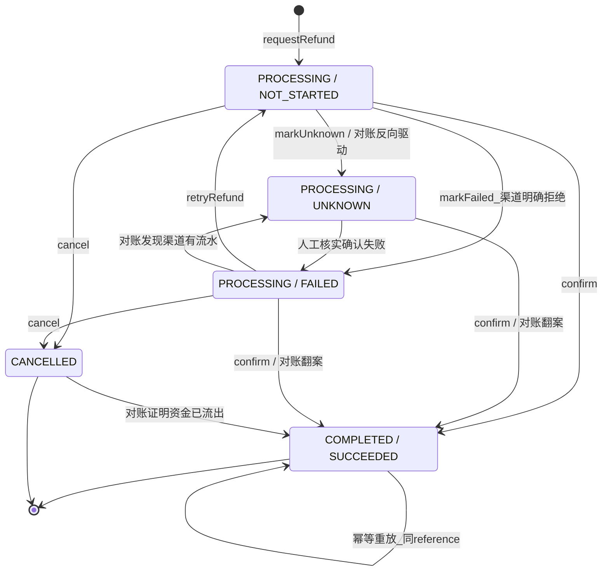
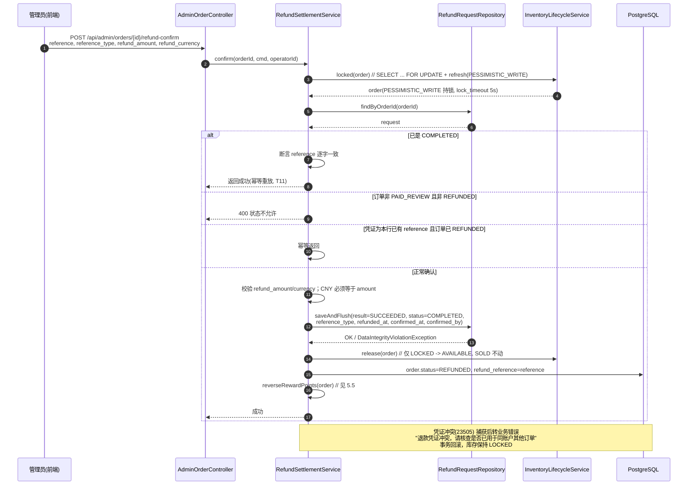
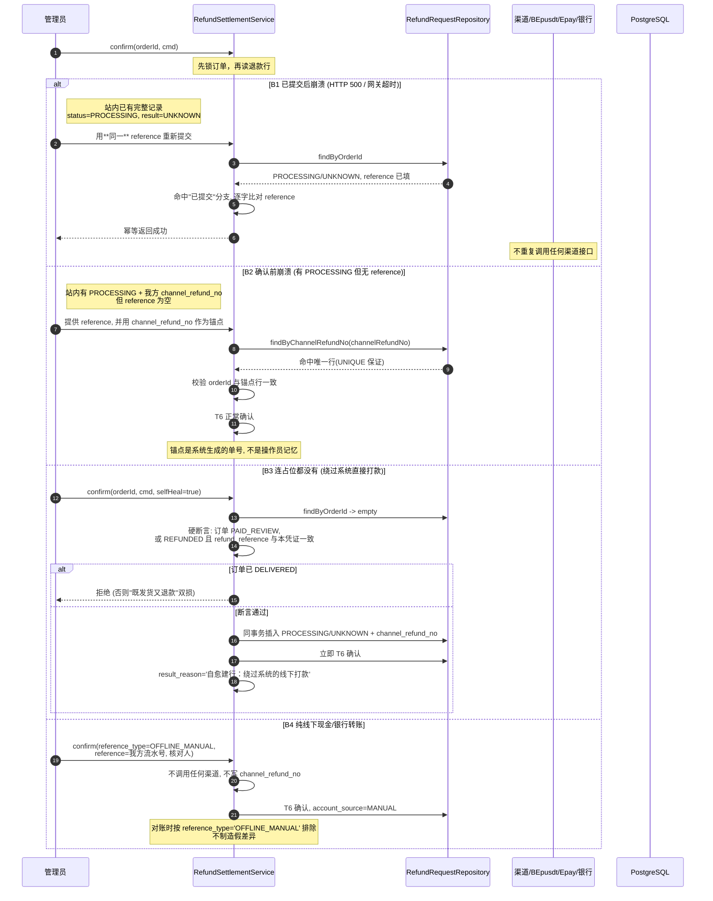
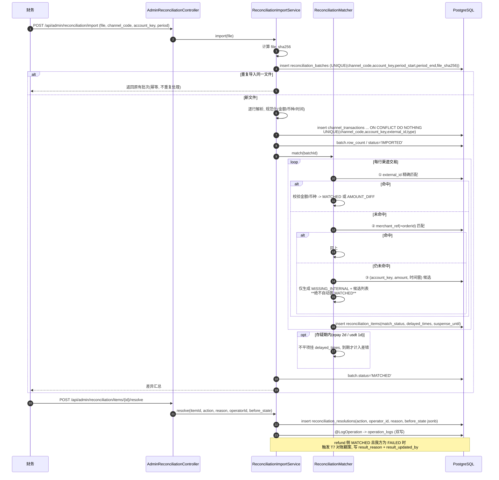

# 第三批：退款确认、超时处置与资金对账

> 文件名沿用 `phase2` 为历史命名；按整体分批口径，本文对应**第三批**（第一批 = `refund-review-phase1.md` 的退款占位与 TXID 审核一致性）。文中的"批次 A / B / C"是本批内部的三小批，不是整体分批。

本批把第一版的"申请占位 + 一句成功"扩成可长期运营的退款管线：退款结果按**流程状态**与**渠道结果确认度**两个维度分别记录，账户信息在下单/申请时**快照落库**，凭证唯一性按**真实收款账户**去重，超时自动提醒与升级，并把渠道流水导入后的三层对账（支付/退款/结算）落到四张表。

本批**不引入积分抵扣功能、不做欠账机制、不做退还抵扣积分**（详见 1.2）。积分只在退款时冲正**已实际发放的奖励积分**，且必须回放事实、不得重算（见 5.5）。

所有并发写入仍走 PostgreSQL 行锁，不引入 `@Version`、不引入 Flyway、不引入消息队列（与第一批一致）。本机 `ddl-auto: update` 只能加列、不能加 CHECK、不能建 partial index，因此本批的约束与索引全部走手写 SQL。

---

## 1 范围与不做的事

### 1.1 本批做什么

| 编号 | 能力 | 落点 |
|---|---|---|
| A | 状态模型双维度（`status` + `result`）、`UNKNOWN → CANCELLED` 硬禁止 | `RefundStatus` / `RefundResult` / 状态机 |
| A | 账户快照六字段组（无 FK）、`account_key` 派生契约 | `RefundRequest` + `RefundAccountResolver` |
| A | 凭证唯一性三条 partial unique index + `reference_type` | 手写 SQL |
| A | 退款金额/币种/时间与提醒字段 | `RefundRequest` |
| A | 补记四路径（B1/B2/B3/B4） | `RefundSettlementService.confirm` |
| A | 积分冲正（回放事实 + 唯一索引 + 夹 0） | `InventoryLifecycleService` |
| A | 修 `confirmPayment` 丢 txid 缺陷 | `InventoryLifecycleService` L81-87 |
| B | 超时巡检、后台待办、邮件提醒、升级 | `RefundWatchService` |
| C | 对账四表、导入、匹配、差异处置 | `Reconciliation*` |

### 1.2 明确不做（不是"以后再说"，是本批的输入前提）

| 不做项 | 原因（可核查的代码事实） |
|---|---|
| 渠道自动退款适配 | BEpusdt 无 refund 端点；Epay 商业版 `/api.php?act=refund` 与新版 `/api/pay/refund` 均无幂等键、无退款结果查询接口。三条件全不满足，自动发起无法做到"崩溃后可判定"。 |
| 复用收款 Inbox（`verified_payment_events`）承载退款 | Inbox 语义是"已验证外部事实的幂等重放"，有自然 `event_key`；退款事实来自**人工陈述**，没有可验证来源，塞进去会把可信表降级。 |
| 自动判定 FAILED | "没查到成功记录"永远不构成失败依据（见 6.4）。 |
| 自动对平账务 / 自动调整内部数据 | 对账只**标记差异**，处置必须由人写入 `reconciliation_resolutions`。 |
| 部分退款 / 多次退款 | `uq_refund_order(order_id)` 明确一笔订单至多一条退款记录，本批不破这个前提。 |
| PAID / DELIVERED 订单退款 | 延续第一批（`requestRefund` L132 只接受 PAID_REVIEW）。 |
| 退款结果邮件通知用户 | 退款是资金异常事件，通知对象是运营，不是用户。 |
| **积分抵扣功能本身** | 用户本期不做，当前代码中**无任何实现**（`orders.pointsDeducted` 恒为 0、`pointsDiscount` 恒为 0）。 |
| **退还抵扣积分** | 依赖抵扣功能存在，前提不成立。 |
| **欠账机制** | 依赖"积分可被消耗"前提，当前不成立（见 5.5 风险提示）。 |

---

## 2 状态模型

### 2.1 为什么拆两个维度

第一批只有一个 `status`，`PROCESSING` 同时承担"还没发起""已发起但不知道结果"两种含义。这两种情况的**处置动作相反**：

- 没发起 → 催办运营去发起（可以撤销申请）
- 结果未知 → 必须去渠道核实，**绝对不能撤销申请**（撤销等于宣布"钱没出去"，而钱可能已经出去了）

jeepay 用 `Result=0` 同时表示这两种含义，是本方案**主动偏离**的第一个点。拆开后：

- `status`（站内流程，我方状态机）：`PROCESSING` / `COMPLETED` / `CANCELLED`
- `result`（渠道结果确认度，外部世界的事实）：`NOT_STARTED` / `UNKNOWN` / `SUCCEEDED` / `FAILED`

`status` 是"我方认为流程走到哪"，`result` 是"我们对外部世界知道多少"。两维组合表达八种情形，其中只有四种合法：

| status | result | 含义 | 允许的下一步 |
|---|---|---|---|
| PROCESSING | NOT_STARTED | 已占位，未向渠道发起 | 发起（→UNKNOWN）、撤销、重试 |
| PROCESSING | UNKNOWN | 已发起，结果不可知 | **只能核实**（→SUCCEEDED 或人工确认 FAILED） |
| PROCESSING | FAILED | 渠道明确拒绝/明确失败 | 重试（→NOT_STARTED）、撤销、对账翻案（→SUCCEEDED） |
| COMPLETED | SUCCEEDED | 已确认退款成功 | 无（终态，仅幂等重放） |
| CANCELLED | NOT_STARTED / FAILED | 已撤销且确认无资金流出 | 对账若证明已流出，→COMPLETED/SUCCEEDED |

`COMPLETED` 必须配 `SUCCEEDED`，`CANCELLED` 必须不配 `UNKNOWN`/`SUCCEEDED` —— 这是两条由代码断言 + 验收 SQL 双重保证的不变量。

> **`CANCELLED` 不是硬终态**：它是"我方声明钱没出去"这个主张。一旦渠道流水/银行账单证伪，必须改判 `COMPLETED/SUCCEEDED`，不能保留 `CANCELLED`。验收 SQL 第 1 条正是检查这个（`CANCELLED` 且订单 `REFUNDED` 判为异常）。

### 2.2 状态图



**`UNKNOWN → CANCELLED` 硬禁止**（图中刻意不画这条边）。落点有三处，缺一不可：

1. `RefundSettlementService.cancel()` 开头 `if (result == UNKNOWN) throw`；
2. 状态机断言表（2.3）中 `cancel` 的前置条件显式写 `result IN (NOT_STARTED, FAILED)`；
3. 验收 SQL 检查 `status='CANCELLED' AND result IN ('UNKNOWN','SUCCEEDED')` 为 0 行。

### 2.3 跃迁表

| # | 从 | 到 | 触发方 | 前置断言（不满足即抛 `BusinessException`，事务整体回滚） | 失败后果 |
|---|---|---|---|---|---|
| T1 | ∅ | PROCESSING/NOT_STARTED | `requestRefund`（管理员） | 订单 `PAID_REVIEW` 且 `paid_at` 非空；`actual_amount > 0`；`order_id` 无既有退款行（`findByOrderId` 先查后写 + `uq_refund_order`） | 400，零写入，LOCKED 库存不动 |
| T2 | P/\* | PROCESSING/UNKNOWN | `markUnknown`（管理员显式标记，含 B2 崩溃补记） | 订单仍 `PAID_REVIEW`；`attempted_at` 落值 | 拒绝，保持原 `result`（保持"可催办"不被污染） |
| T3 | P/\* | PROCESSING/UNKNOWN | 对账反向驱动（渠道出现我方标 `FAILED`/`NOT_STARTED` 的退款） | 该退款已进入本次导入的批次 | 跳过该行并计入 `UNKNOWN_RESULT` 差异项，不改状态 |
| T4 | P/NOT_STARTED | PROCESSING/FAILED | `markFailed`（渠道明确返回失败码） | `result_reason` 必填（≤500），且必须是**渠道明确响应**；"查不到"不合法 | 拒绝 |
| T5 | P/UNKNOWN | PROCESSING/FAILED | 人工核实后确认失败 | `result_reason` 必填 + `result_updated_by` 非空 | 拒绝 |
| T6 | PROCESSING/\* | COMPLETED/SUCCEEDED | `confirm`（B1/B2/B3/B4 四路径共用） | 订单 `PAID_REVIEW`，或 `REFUNDED` 且 `refund_reference` 与本行凭证一致；`reference` 非空；`refund_amount`/`refund_currency` 非空；`refund_currency='CNY'` 时 `refund_amount = amount`；`result_reason` 记录"经哪条路径确认" | 400 回滚，不加锁残留、不写半截 |
| T7 | PROCESSING/FAILED | COMPLETED/SUCCEEDED | 对账翻案（外部事实优先） | `result_reason` 必填 + `result_updated_by` 非空；货已发（`DELIVERED`）则拒绝 | 拒绝（见 4.2 B3 双损护栏） |
| T8 | P/NOT_STARTED、P/FAILED | CANCELLED | `cancel`（撤销申请） | **`result = UNKNOWN` 硬禁止**；`reference` 为空（钱没出去就不该有凭证） | 拒绝，提示先核实渠道 |
| T9 | CANCELLED | COMPLETED/SUCCEEDED | 对账翻案 | 同 T7，并额外要求 `result_reason` 说明撤销后为何仍流出 | 拒绝 |
| T10 | P/FAILED | P/NOT_STARTED | `retryRefund`（重试发起） | 订单仍 `PAID_REVIEW`；`FAILED` 必须是明确失败 | 拒绝 |
| T11 | COMPLETED/SUCCEEDED | COMPLETED/SUCCEEDED | 幂等重放（重复确认） | 传入 `reference` 与库内**逐字一致**（`equals`，不 trim 后比较以外不做事） | 不一致即 400，回滚 |
| T12 | COMPLETED/\* | 任意 | 任何其他操作 | 一律拒绝（终态保护） | 400 |

`FAILED` 的三条硬约束（写进代码注释，也写进这里）：

- **不自动释放 LOCKED 库存**：`release()` 只在 T6/T9 后被调用；
- **不自动改订单状态**：订单保持 `PAID_REVIEW`，继续禁止发货；
- **不自动重试**：没有任何调度器会把 `FAILED` 改成 `NOT_STARTED`，只能人工 `retryRefund`。

### 2.4 CHECK 约束的迁移陷阱（必读）

第一批的 `refund_requests.status` 带着自动命名 CHECK：

```sql
-- apps/api/src/main/resources/db/refund-review-phase1.sql L22
status varchar(255) NOT NULL CHECK (status IN ('PROCESSING','SUCCEEDED'))
```

`COMMITTED` 不在这个集合里，写入会直接报 `23514`。而 `ddl-auto: update` **永远不会修改已存在的 CHECK 约束**（Hibernate 只在建表时生成，之后对 CHECK 无操作）。所以必须脚本 `DROP` 后重建。

由于该 CHECK 是**匿名**的，实际名由 PG 生成（通常是 `refund_requests_status_check`），**不能硬编码**。先查：

```sql
SELECT conname, pg_get_constraintdef(oid) FROM pg_constraint
WHERE conrelid = 'refund_requests'::regclass AND contype = 'c';
```

再按 `pg_get_constraintdef` 内容匹配后 `DROP`（8.2 步骤 5 给了 `DO` 块写法）。同理 `amount numeric(10,2) CHECK (amount > 0)` 也是匿名的，本批不动它。

---

## 3 数据模型

### 3.1 账户快照：六字段组，不用 FK

| 字段 | 类型 | 说明 |
|---|---|---|
| `payment_channel_id` | uuid | 创建时的渠道行 id，**普通索引，不加 FK** |
| `refund_channel_code` | varchar(64) | 快照的 `channelCode`（逻辑支付方式，如 `usdt_trc20`） |
| `refund_provider_type` | varchar(32) | 快照的 `providerType`（`epay`/`usdt`/…） |
| `account_key` | varchar(200) | 派生账户标识（见 3.2），凭证去重的前缀 |
| `account_label` | varchar(200) | 人读标签，展示用 |
| `account_source` | varchar(20) | `SNAPSHOT` / `MANUAL` / `LEGACY_UNKNOWN` |

**为什么不用 FK（四条理由，按严重度排序）：**

1. `PaymentChannel.configData` 是**原地 UPDATE** 的 TEXT 列。运营改 pid 后，FK 让历史退款行"读出"新 pid —— 资金凭证被追溯篡改，对账时看到的是"退款打到了 A 账户"而实际打到 B。
2. 渠道软删（`isDeleted=1`）或物理删除会让退款凭证**丢失关联**，`JOIN` 出空，对账漏一片。
3. 退款账户可能根本不在 `payment_channels` 里（线下银行账户、备用钱包、临时打款账户）。
4. 同一个 `payment_channel_id` 在不同时期可能是不同账户（epay 换 pid 但没换渠道行）。

结论：**退款凭证是资金事实，事实必须自包含**。快照字段一旦写入不再更新（`@Column(updatable=false)` 或服务层不写），这是本批最重要的数据契约。

### 3.2 `account_key` 派生契约

| `provider_type` | `account_key` | `account_label` 示例 | 取值来源（已核实） |
|---|---|---|---|
| `epay` | `epay:pid={pid}` | `易支付 商户号 1001` | `configData.pid`（`PaymentServiceImpl.buildChannelConfig` L177 读取） |
| `usdt` | `usdt:{chain}:{wallet_address.toLowerCase()}` | `USDT trc20 钱包 TQrY…9xZp` | `orders.usdt_wallet_address` + `orders.usdt_chain`（**不是 configData**，见下） |
| `native_alipay` | `alipay:{app_id}` | `支付宝应用 2021…` | 约定：`configData.app_id`（当前无实现，见下） |
| `native_wxpay` | `wxpay:{mch_id}` | `微信商户 1500…` | 约定：`configData.mch_id`（当前无实现，见下） |
| 线下 / 无法识别 | `manual:{操作员填写}` | 操作员填写 | 人工录入 |

**两处与口头设计不一致，以代码为准（已在本次核对中修正）：**

- **USDT 钱包地址不在 `configData` 里**。`buildBepusdtConfig`（`PaymentServiceImpl` L129-139）只读 `api_url`/`api_token`/`notify_url`/`redirect_url`/`trade_type`/`fiat`/`timeout`/`fixed_rate`，**没有钱包地址**；地址是下单时 BEpusdt 接口返回的 `data.token`（`BepusdtServiceImpl` L112 `getString(data,"token")`），由 `PaymentServiceImpl` L115 写入 `order.usdtWalletAddress`。
  因此 USDT 的 `account_key` 必须从**订单快照**（`orders.usdt_wallet_address`、`orders.usdt_chain`）派生。这反而更符合"快照"原则：下单时的收款地址就是客户实际打款地址。`configData.trade_type`/`fiat` 不作为账户标识（它们不是收款主体）。
- **`native_alipay` / `native_wxpay` 目前是死路径**：`PaymentServiceImpl` L90-91 直接抛 `CHANNEL_UNAVAILABLE("原生支付宝支付尚未实现")`。所以库里不存在这两类的真实订单。派生规则先按约定写好（前向兼容），但实现时必须先给 `configData` 补 `app_id`/`mch_id`，改这两行属于新功能，不在本批。

派生实现要求：`RefundAccountResolver.resolve(order, request)` 只读 `configData` 中**标识性字段**，用完立即丢弃整个 map，**不允许把解析结果整体留存**（见第 10 节）。派生失败（字段缺失、渠道已删）时**不阻断申请**：退回 `account_source='MANUAL'` + 强制操作员填写账户，因为"收了钱但不知道收在哪"也必须能退款。

### 3.3 `reference_type` 与三条 partial unique index

```sql
CREATE UNIQUE INDEX uq_refund_account_reference ON refund_requests (account_key, reference)
  WHERE result = 'SUCCEEDED' AND reference IS NOT NULL AND reference_type = 'CHANNEL_NO';

CREATE UNIQUE INDEX uq_refund_chain_txid ON refund_requests (reference)
  WHERE result = 'SUCCEEDED' AND reference_type = 'CHAIN_TXID';

CREATE UNIQUE INDEX uq_refund_offline_reference ON refund_requests (reference)
  WHERE result = 'SUCCEEDED' AND reference_type = 'OFFLINE_MANUAL';

ALTER TABLE refund_requests ADD CONSTRAINT ck_refund_channel_no_needs_account
  CHECK (reference_type <> 'CHANNEL_NO' OR account_key IS NOT NULL);
```

三类凭证的语义差异是三条索引而非一条的原因：

- `CHANNEL_NO`（渠道退款单号）：**只在同一收款账户内唯一**。不同 pid 的同号是完全合法的两笔钱。
- `CHAIN_TXID`（链上哈希）：**全局唯一**。链上哈希跨账户跨链也不会重复（重复即双花或数据错误）。
- `OFFLINE_MANUAL`（线下现金/银行转账流水）：**全局唯一**，但这类凭证是我们自己编的号，天然唯一；索引的作用是拦住操作员手滑复用同一个编号。

`reference_type` **必须可空**，不能 `NOT NULL DEFAULT`：第一批的历史行没有这个信息，给默认值等于伪造。

```sql
ALTER TABLE refund_requests ADD COLUMN reference_type varchar(32);
-- 不设 NOT NULL、不设 DEFAULT。历史行为 NULL。
```

### 3.4 旧唯一键 `uq_refund_channel_reference` 的三处缺陷

第一批：`@UniqueConstraint(name="uq_refund_channel_reference", columnNames={"payment_method","reference"})`（`RefundRequest.java` L14）与 phase1 SQL L30 同名约束。

| 缺陷 | 机制 | 后果 |
|---|---|---|
| 前缀是 `payment_method`（逻辑支付方式），不是账户 | 同渠道换 pid 后，新账户的合法单号被旧账户的历史行"占号" | 合法退款登记被拒 → 运营为绕过限制**手改流水号** → 这才是资损的真正起点 |
| 不同 `payment_method` 指向同一 pid 时不去重 | 一个 epay 账户挂多个渠道码，同一笔流水可在两个渠道码下各登记一次 | 一笔钱记成两笔退款 |
| PG 的 `UNIQUE` 对 NULL 不去重 | `payment_method` 可空（列无 `NOT NULL`），NULL 参与的唯一约束对 NULL 行完全失效 | `payment_method IS NULL` 的行**完全裸奔**，任意重复 |

新方案用 `account_key` 做前缀，并让"账户未知"的行落到 `reference_type IS NULL` 从而**主动退出**索引（宁可不管，也不假装管住）。

### 3.5 其余增量字段

| 字段 | 类型 | 用途与理由 |
|---|---|---|
| `channel_refund_no` | varchar(128) UNIQUE | **我方预生成**的退款单号，**确认前就落库**。B2 场景（确认前崩溃）的唯一补记锚点：锚点是系统生成的单号，不是操作员记忆。UNIQUE 保证不会并发生成两条占位。 |
| `refund_amount` | numeric(18,6) | 实际退款金额。**不复用 `amount`（numeric(10,2)）**：USDT 需 3~6 位小数，`10,2` 会截断，截断即丢钱且事后无法从库里发现。 |
| `refund_currency` | varchar(16) | 实际退款币种（可能与结算币种不同，如结算 CNY 但退 USDT） |
| `refunded_at` | timestamp | **实际退款发生时间**（渠道/链上时间），与 `confirmed_at`（我方确认动作时间）严格分离。对账时间窗、`delayed_times` 判定都只能用它。 |
| `result_reason` | varchar(500) | 为什么是这个 `result`。T4/T5/T7/T9 必填，是"谁在什么依据下改判"的唯一文字证据。 |
| `attempted_at` | timestamp | 首次向渠道发起的时间。`NOT_STARTED` 2h 提醒以它为准。 |
| `reminder_count` | int default 0 | 已提醒次数（先落库后发信，见 6.3） |
| `last_reminded_at` | timestamp | 上次提醒时间 |
| `next_remind_at` | timestamp | 下次应提醒时间（**巡检按它取行**，索引 `(status, next_remind_at)`） |
| `escalated_at` | timestamp | 升级时间（只改可见性与排序） |
| `unknown_since` | timestamp | 进入 `UNKNOWN` 的时刻。UNKNOWN 的 30min/4h×3 阈值从它起算，不能用 `updated_at`（任何字段更新都会改 `updated_at`）。 |
| `result_updated_by` | uuid | 改判 `result` 的操作者。系统对账驱动的改判写 `NULL` 并在 `result_reason` 注明"对账批次 #id"。 |

### 3.6 历史回填：不伪造

延续 phase1 L32 的"不臆造"原则，`payment_method='legacy_unknown'` 或来源不明的行：

| 字段 | 回填值 | 理由 |
|---|---|---|
| `reference` | 不动 | 原值保留 |
| `refund_channel_code` | `NULL` | 不知道 |
| `refund_provider_type` | `NULL` | 不知道 |
| `account_key` | `NULL` | 不知道 |
| `account_source` | `'LEGACY_UNKNOWN'` | 显式标记"这是不知道" |
| `account_label` | `'历史迁移：账户与渠道未知'` | 人读提示 |
| `reference_type` | `NULL` | 不知道 |

**为什么选 NULL 而不是哨兵值（如 `legacy:unknown`）**：如果历史数据本身就存在"不同 pid 同号"，填哨兵会让它们挤进同一个 `account_key` 前缀，`uq_refund_account_reference` 直接**建不起来**，迁移卡死。填 NULL 则三条索引都带 `reference IS NOT NULL` 与 `reference_type='...'` 条件，历史行自然不参与，实现"部分历史不可考证"与"新数据严格去重"共存。

**必须写进运维手册的连带后果**：若后期给某条历史行补 `reference_type`，该行会**突然进入**唯一索引。补之前必须先查重，否则 `CREATE INDEX`/`UPDATE` 会失败：

```sql
SELECT reference, count(*) FROM refund_requests
WHERE reference IS NOT NULL AND reference_type IS NULL GROUP BY 1 HAVING count(*) > 1;
```

`status`/`result` 的回填（见 8.2 步骤 4）分两类：

- `status='SUCCEEDED'` → `status='COMPLETED'`, `result='SUCCEEDED'`（第一批确认成功的语义就是"钱已出去"）
- `status='PROCESSING'` → `status='PROCESSING'`, `result='UNKNOWN'`, `unknown_since=coalesce(attempted_at, created_at)`, `result_reason='第一批迁移：历史申请未记录渠道结果，需人工核实'`

**为什么 PROCESSING 回填成 UNKNOWN 而不是 NOT_STARTED**：第一批的 `PROCESSING` 允许"运营已在渠道手工退款但没回来登记"这种状态，库里无法区分。两个方向的错误代价不对称：

- 错标 `NOT_STARTED` → 允许 `cancel`（T8 只拦 `UNKNOWN`）→ 把已流出的钱标记为"未发生"，直接资损；
- 错标 `UNKNOWN` → 最多多几条提醒、不允许撤销，运营被迫核实一遍。

**取代价小的方向**：一律 `UNKNOWN`。这也是"不臆造"的严格解释：不能臆造"未发起"这个更强的断言。

### 3.7 为什么仍然不加 `@Version`

全项目零 `@Version`（`BaseEntity` 只有 `id`/`createdAt`/`updatedAt`）。本批不破例：

- 所有写路径的第一句都是 `locked(order)`（`InventoryLifecycleService` L225-231：`findByIdForUpdate` + `entityManager.refresh(PESSIMISTIC_WRITE)` + `set local lock_timeout='5s'`），订单行锁把同一订单的所有退款写入串行化；
- `RefundRequest` 的写路径全部由 `order_id` 定位（`findByOrderId`），所以订单行锁天然覆盖退款行；
- 巡检任务（批次 B）用 `findById` + 独立事务，只写提醒字段（`reminder_count`/`last_reminded_at`/`next_remind_at`），这些字段**不参与任何业务判定**，脏写最坏是多发一封邮件；
- `@Version` 会引入一个新失败模式（`OptimisticLockException` 需要重试策略），而当前并发只在"同一订单"这一个极窄维度上，行锁已经够用。

对账导入（批次 C）是唯一会大量并发写的场景，用 `ON CONFLICT DO NOTHING` + `reconciliation_batches` 的 `file_sha256` 唯一键做幂等，同样不需要 `@Version`。

---

## 4 关键流程

### 4.1 正常确认（T6）



关键点：

- **锁序固定**：订单行 → 退款行 → 库存行 → 用户行（积分冲正）。与第一批 `TxidReviewService`（审核 → 订单 → 库存）方向一致，不会与付款回调互锁。付款回调 `confirmPayment` 也先锁订单，所以在退款确认持锁期间到账的回调只会等待，随后看到 `refunds.existsByOrderId` 立即返回。
- **`release()` 语义不变**（L118-125）：只把 `LOCKED` 改回 `AVAILABLE`，`SOLD` 不动。退款只可能发生在未发货（PAID_REVIEW）场景，理论上不会有 `SOLD`；若出现 `SOLD` 说明数据异常，不动它比乱动安全。

### 4.2 补记四路径

"补记"= 钱已经动了，但系统里没有完整记录。四条路径的共同入口是 `confirm`，区别只在进入前的现场。



**B3 的双损护栏是这条路径存在的唯一理由**。允许"自愈建行"是因为线上系统漏记是现实；但必须断言订单处于"钱进来了、货没出去"的状态。若订单已 `DELIVERED`，说明**货已发且钱已退**——这是双损，必须人工裁决，系统不给人开这条路。

**B4 不是降级方案而是正解**：线下现金退款永远不会出现在渠道流水里。给它独立的 `reference_type` 让对账 SQL 能一键排除，比"让它假装是渠道退款然后被报差异"正确得多。

### 4.3 对账导入 → 匹配 → 处置



匹配顺序的**硬规则**：`external_id` 精确 → `merchant_ref` → 候选。第三级只是"给人看的疑似候选"，任何情况下都不自动置 `MATCHED`。理由：`(账户, 金额, 时间窗)` 在促销、批量退款、同价商品并发的场景下会大量误配，一次误配就把真差异掩盖成"平"。

---

## 5 幂等五层

### 5.1 ① 请求级：按钮 disabled + 业务幂等键

前端已有模式可复用：`apps/web/app/admin/orders/page.tsx` L58 `const [refundBusy, setRefundBusy] = useState(false)`，L540-541 三个按钮都 `disabled={refundBusy}`，L541 文案 `refundBusy ? "处理中…" : ...`。

服务端不以按钮为准，以业务幂等键为准：

- 确认的唯一键是 `channel_refund_no`（我方预生成，见 3.5）；重放同一单号返回同一结果；
- 登记凭证的唯一键是三条 partial unique index（5.3）。

**不引入通用幂等中间件**，理由：项目已有 `orders.idempotency_key`（`Order` L63-64 `@Column(unique = true) private String idempotencyKey`）这种"业务自带键"的先例，通用中间件会引入 Redis 依赖与 TTL 语义，而退款的幂等窗口是**无限期**（一年后重放也必须幂等），缓存类中间件表达不了这个语义。

### 5.2 ② 记录级：`UNIQUE(order_id)` + 先查后写 + 订单行锁

`requestRefund` 现状即正确：L131 `locked(id)` → L134 `findByOrderId` → L135 命中即 `return existing.get()` → 否则插入。`uq_refund_order` 兜底并发（两个请求同时通过 `findByOrderId` 时，插入会撞唯一键）。

本批只需在插入时补齐新字段，**不改这个结构**。注意 `@Table` 上 `uq_refund_order` 必须保留（见 8.2 步骤 7）。

### 5.3 ③ 凭证级：三条 partial index + 异常转译

沿用第一批已有的转译模式（`InventoryLifecycleService` L169-172）：

```java
try { refunds.saveAndFlush(request); }
catch (org.springframework.dao.DataIntegrityViolationException conflict) {
    throw new BusinessException(ErrorCode.BAD_REQUEST,"退款凭证冲突，请核查是否已用于同账户其他订单");
}
```

必须 `saveAndFlush`（不能 `save`）—— 只有 flush 才会触发数据库约束，才能被这里捕获。

### 5.4 ④ 状态级：状态机断言 + 行锁 + 逐字比对

`COMPLETED/SUCCEEDED` 的重复确认必须 `reference` **逐字一致**。不是 `equalsIgnoreCase`、不是 `trim` 后比较、不是"前缀相同"。理由：退款凭证是对账的对齐键，宽松比较会让"Z20250101A"与"z20250101a"合并或分裂，取决于比较方式，两种结果都会让对账账不平。

### 5.5 ⑤ 积分冲正

退款时冲正**已实际发放**的奖励积分，**必须回放事实、不得重算**：查 `points_logs WHERE order_id=? AND reason='购物奖励积分'` 取实际 `change_amount` 反向写一条 `reason='退款冲正'` 的负数记录，并同步 `users.points`。不能重算的原因是 `awardPoints`（`InventoryLifecycleService` L232-263）依赖**运行时的** `points_enabled` 与 `points_rate`（L234-242 从 `site_configs` 现读）：退款时重算会得到 0（开关已关）或不同值（费率已改），两个方向都是错的——得 0 会让积分凭空增加，得大值会让余额变负。

四条实现约束：

1. **防重复**：`CREATE UNIQUE INDEX uq_points_reversal_once ON points_logs(order_id) WHERE reason='退款冲正'`（只能靠 partial index，`PointsLog` 上没有 `order_id` 唯一约束，且同 `order_id` 允许存在多条奖励记录）。
2. **找不到原始奖励记录就什么都不做**：`awardPoints` 在 L233（无 `userId`）、L237（积分未启用）、L242（费率为 0）、L246（计算结果 ≤0）四处会**静默 `return`**，所以"没有奖励记录"是常态，不是异常。
3. **防御性夹 0**：理论上不可达，但若 `user.points < 应扣额` 则夹到 0 并 `log.warn` 输出订单号与差额，**不建欠账表、不加字段、不阻断退款事务**。这是"理论上不可达的防御分支，不是业务规则"——写死在代码注释里，避免后人误认为它是产品需求。
4. **加行锁读用户**：沿用 L250 `userRepository.findByIdForUpdate(order.getUserId())`，否则 `balanceAfter` 会与 `users.points` 实际值不一致。锁序：订单 → 退款 → 库存 → 用户，与 `awardPoints` 一致。

> **必须保留的风险提示**
>
> 当前积分只有发放、没有任何消耗途径（全项目 `setPoints(` 只有 `UserProfileResponse:28` 的读取与 `InventoryLifecycleService:253` 的 `+=`，无抵扣/兑换/提现/管理员调减），因此冲正不会产生负余额。**将来一旦引入任何积分消耗途径，必须先补"应扣未扣"的欠账护栏**，否则退款冲正要么导致余额为负、要么让已消费的积分凭空复活形成套利。届时需重新设计本段。

### 5.6 澄清：退款场景不存在渠道回调

BEpusdt 与 Epay **都没有退款通知**。所谓"重复回调"在这个系统里实际是：**付款回调在退款之后重放**。现状已被 `refunds.existsByOrderId(id)` 拦住（`confirmPayment` L81-82）。

但这个拦截本身引出一个必须在本批修掉的缺陷。

### 5.7 必修缺陷：`confirmPayment` 丢 txid

现状（`InventoryLifecycleService` L81-87）：

```java
if (order.getStatus() == OrderStatus.REFUNDED || order.getStatus() == OrderStatus.DELIVERED
        || refunds.existsByOrderId(id)) return order;   // ← 提前返回
if (txid != null) {
    if (order.getUsdtTxId() != null && !txid.equals(order.getUsdtTxId())) throw ...;
    order.setUsdtTxId(txid);                             // ← 永远到不了
}
```

注释声称 "Preserve the receipt"（保留回执），实际**回执从未保存**：存在退款占位时，函数在赋值之前就返回了。后果是 `orders.usdt_tx_id` 为空，而它正是对账时**支付侧的对齐键**——这批付款在对账里会变成"渠道有、本端无"的缺单，制造无法收敛的假差异。

修法（批次 A，不改变"禁止发货"语义）：把 txid 写入提到提前返回**之前**，并保留"写回执但不分配、不发货"。

```java
Order order = locked(id);
if (txid != null) {
    if (order.getUsdtTxId() != null && !txid.equals(order.getUsdtTxId()))
        throw new BusinessException(ErrorCode.TXID_ALREADY_USED, "订单已关联其他交易");
    order.setUsdtTxId(txid);          // 回执先落库
    if (order.getPaidAt() == null) order.setPaidAt(LocalDateTime.now());
}
// 退款占位/已终结：回执已保存，绝不分配、绝不发货
if (order.getStatus() == OrderStatus.REFUNDED || order.getStatus() == OrderStatus.DELIVERED
        || refunds.existsByOrderId(id)) return order;
```

注意 `orderRepository.saveAndFlush` 的必要性：提前返回路径上若不 flush，脏数据仍会在事务提交时写入（JPA 脏检查），但如果调用方是只读事务或后续抛异常，回执就丢。显式 `saveAndFlush(order)` 更稳。

---

## 6 超时与提醒（批次 B）

### 6.1 巡检任务形态

新增 `RefundWatchService`：

```java
@Scheduled(fixedDelayString = "${refund-watch.poll-ms:60000}")   // 注意是 fixedDelay
public void tick() { ... }
```

- **不用 `fixedRate`**。`OrderServiceImpl.expireOrders` L371 用的是 `@Scheduled(fixedRate = 60000)`，单轮超过 60s 时 Spring 会继续按节拍投递任务、堆积执行；退款巡检会发邮件（慢操作），必须用 `fixedDelay`（上一轮结束后再等 60s）。
- **每轮最多 50 条**，按 `next_remind_at` 升序取（`ORDER BY next_remind_at LIMIT 50`），避免积压时一次拉起几千封邮件。
- **单条失败 `try/catch + continue`**，照抄 `expireOrders` L374-378 的模式：

```java
for (RefundRequest r : due) {
    try { remind(r.getId()); }
    catch (RuntimeException busy) { log.warn("Refund reminder deferred: {} ({})", r.getId(), busy.getClass().getSimpleName()); }
}
```

- **本期不引入分布式锁**。理由：单实例部署（`docker-compose.yml` 只有一个 `api` 服务，无 `replicas`）。将来多实例时可用项目已有的 `pg_advisory_xact_lock` 范式（`InventoryLifecycleService.lockRequest` L216-223 的 FNV-1a 哈希 + `ProductPublicationBarrier` L30 的固定 key 写法），按 `order_id` 哈希取锁，不需要新组件。
- 每条的提示字段更新用**独立事务**（`REQUIRES_NEW` 或 service 方法内 `@Transactional`），一条失败不拖累同批其他行。

### 6.2 阈值

| 情形 | 首提醒 | 后续 | 次数上限 | 依据字段 |
|---|---|---|---|---|
| `PROCESSING / NOT_STARTED` | 2h | 每 12h | 不限（运营没做就一直提醒） | `created_at`（或 `attempted_at`） |
| `PROCESSING / UNKNOWN` | 30min | 每 4h | 共 3 次 | `unknown_since` |
| 任意 `PROCESSING` | 24h 写 `escalated_at` | 升级后每日一次 | — | `created_at` |

`UNKNOWN` 的次数**必须封顶 3 次**：结果未知是一个"等外部世界给答案"的状态，状态本身不会因为提醒而变化。无限提醒只会让运营对红点免疫，反而降低真实告警的信噪比。3 次之后转为"24h 升级 + 每日一次"，靠升级后的排序把它顶到列表最上面。

`NOT_STARTED` 不封顶的理由相反：这是"我方该做没做"，责任在我方，提醒到做完为止。

### 6.3 两个通道，主通道必达

| 通道 | 语义 | 实现 |
|---|---|---|
| 主：后台待办红点 / 列表置顶 | 读库即可见，**必达** | `DashboardService` 加计数；`admin/orders` 列表按 `escalated_at DESC, next_remind_at ASC` 排序 |
| 次：邮件 | 提醒运营主动处理，**可能失败** | `EmailService.sendRefundReminder(...)` |

**关键约束（最容易写错的地方）**：提醒事实**先落库提交**，`reminder_count` / `last_reminded_at` / `next_remind_at` 的推进**不得以邮件发送结果为条件**。

原因链：`EmailServiceImpl` 的 `sendDeliveryEmail` 是 `@Async`（L49）且 catch 后仅 `log.error`（L86-90），**调用方拿不到任何失败信号**——方法签名就是 `void`。`mail.enabled` 在 `@Value` 里默认 `false`（L38），在 `application.yml` L73 默认 `true`，两者叠加后实际默认 `true`，也就是说默认会真的尝试连 `mail.example.com`（L39 占位符）并失败。若把计数挂在这条链路上，**SMTP 挂掉的那天起提醒永不计数、永不升级**，红点也永远不亮——最需要告警的时候系统静默。

正确顺序：

```java
// 1) 先提交提醒事实（独立事务）
refunds.save(advanceReminderState(r));
// 2) 事务提交后再尽力发信；返回值忽略（本来就是 void）
emailService.sendRefundReminder(r.getId());
```

收件人取 `site_configs` 的 `admin_alert_email`（新增 config key），**不发用户**：退款是资金异常，用户收到只会引发客服工单。若 `admin_alert_email` 未配置，邮件通道静默跳过，主通道照常工作——这是唯一允许"少发一封信"的场景。

### 6.4 `UNKNOWN` 的三个来源

| 来源 | 触发点 | 说明 |
|---|---|---|
| 管理员显式标记 | `markUnknown`（T2） | 运营在渠道后台点了退款、页面报超时/500，拿不到明确结果 |
| **对账反向驱动** | 渠道流水中出现我方标 `FAILED`/`NOT_STARTED` 的退款（T3） | 这是最可靠的一路：外部事实优先于我方记录 |
| 未来接自动退款时的 IO/超时/5xx | 本期不实现 | 预留在状态机里 |

**"没查到成功记录"永远不构成 `FAILED` 依据。** 这是本批最重要的一条判定纪律，落地为三条代码规则：

1. `markFailed` 必须携带渠道的**明确**失败响应（错误码/`RAWTEXT`），仅凭"我没看到"调用直接拒绝；
2. 对账匹配器的 `MISSING_CHANNEL`（本端有、渠道无）只能生成 `MISSING_CHANNEL` 差异项，**不能**改 `result`；
3. `UNKNOWN` 转 `FAILED`（T5）要求 `result_updated_by` 非空，即必须有人签名负责。

### 6.5 升级只改可见性

`escalated_at` 的唯一作用是**排序与红点**。升级不释放库存、不改订单状态、不自动建对账项、不发"自动退款"请求。原因：升级发生在"我们已经不知道发生了什么"的时刻，此刻任何自动动作都是在信息缺失下改资金事实。

---

## 7 对账匹配规则（批次 C）

### 7.1 四张表

| 表 | 关键字段 | 唯一键 |
|---|---|---|
| `channel_transactions` | `channel_code`、`account_key`、`external_id`、`merchant_ref`、`parent_external_id`、`type`(`PAYMENT`/`REFUND`)、`amount`、`currency`、`fee`、`occurred_at`、`raw` jsonb | `UNIQUE(channel_code, account_key, external_id, type)` —— 保证重复导入幂等 |
| `reconciliation_batches` | `channel_code`、`account_key`、`period_start`、`period_end`、`file_sha256`、`row_count`、`status` | `UNIQUE(channel_code, account_key, period_start, period_end, file_sha256)` —— 同一文件重复上传不重复处理 |
| `reconciliation_items` | `batch_id`、`match_status`、`internal_id`、`channel_tx_id`、`diff_amount`、`delayed_times`、`suspense_until` | 无（按 batch 追加） |
| `reconciliation_resolutions` | `item_id`、`action`、`operator_id`、`reason`（必填）、`before_state` jsonb | 无（允许同一 item 多次处置，形成历史） |

`match_status` 取值：`MATCHED` / `AMOUNT_DIFF` / `MISSING_INTERNAL`（渠道有本端无）/ `MISSING_CHANNEL`（本端有渠道无）/ `DUPLICATE` / `UNKNOWN_RESULT`。
`action` 取值：`ACCEPT_AS_IS` / `ADJUST_INTERNAL` / `MARK_OFFLINE` / `RE_RECONCILE` / `ESCALATE`。

字段命名说明：渠道交易里叫 `account_key` 而不是 `account`，与 `refund_requests.account_key` 同源同派生契约（见 3.2），这样退款层与渠道层可以直接 `= ` 连接，不需要任何映射函数。

### 7.2 三层不合并

| 层 | 本端 | 渠道侧 | 不平意味着 |
|---|---|---|---|
| 支付层 | `orders`（+ `verified_payment_events`） | 渠道 PAYMENT 交易 | 收了钱没记单，或记了单没收到钱 |
| 退款层 | `refund_requests` | 渠道 REFUND 交易 | 退了钱没记，或记了没退（本条最危险） |
| 结算层 | `settlement` 快照（`Order.paymentAmount/paymentCurrency` 与 `SettlementService` 报价） | 渠道手续费/汇率 | 手续费或汇率差，不是笔数差 |

**不合并成一张表**：合成一张只能得出"平/不平"，看到"不平"也不知道不平在哪一层，等于把三倍的诊断信息压成一比特。三层各自有独立的时间窗、容差与匹配键，强行统一会逼出一堆 `type` 判断分支。

### 7.3 匹配键必须是渠道侧不可变 ID

**禁止**用"邮箱 + 金额 + 日期"这类组合键。它们每一个都可能合法重复：同一用户同一天买两件同价商品，组合键完全相同。用组合键匹配会产生"一笔钱匹配到两笔订单然后又都不平"的连锁错误。

允许的匹配键只有两个半：

1. `external_id`（渠道交易号）—— 精确匹配，唯一权威；
2. `merchant_ref`（= 我们的 `order_id` / `channel_refund_no`，即渠道回传的 `out_trade_no`）；
3. `(account_key, amount, 时间窗)` —— **仅生成疑似候选**，绝不自动置 `MATCHED`。

### 7.4 退款侧的特殊性

渠道退款会**生成一个新的交易号，不修改原支付交易号**。所以退款交易与支付的关联必须显式记录：

- `channel_transactions.parent_external_id` 回指原支付交易号；
- 校验三道，全过才算关联成功：① 退款金额 ≤ 原支付金额；② 币种一致；③ 原支付交易号在本端存在（`channel_transactions` 或 `orders`）。

任一道不过，`match_status` 记 `UNKNOWN_RESULT` 并保留 `parent_external_id` 原值供人工判断，**不做修正**。

### 7.5 容差按币种

| 币种 | 容差 | 理由 |
|---|---|---|
| CNY | **零容差**（`<>` 即差异） | 分为最小单位，`numeric(18,6)` 存人民币不存在舍入 |
| USDT | `abs(diff) <= 0.001` | 链上转账扣除 gas 后可能差最小单位；`orders.usdtCryptoAmount` 注释即"精确加密货币金额（3 位小数）" |

容差写死在代码常量里，**不做成可配置**：容差可配置意味着"调大容差让账平了"，这是对账系统最常见的自欺方式。

### 7.6 存疑期（`delayed_times` / `suspense_until`）

日切、跨时区、渠道 T+1 入账都会让"今天不平"变成"明天平了"。直接判差异会产生大量假阳性，运营对着假差异疲劳之后就会开始点 `ACCEPT_AS_IS`——那时真差异也会被点掉。

- 不平项先挂 `delayed_times`（延迟轮次）+ `suspense_until`（到期时间）；
- `suspense_until` 到期仍不平才**计入差错**并计入待办；
- 建议值：epay **2 天**、usdt **1 天**（链上确认快，但跨时区日切仍存在）；
- 存疑状态**内联在 `reconciliation_items` 里**，不建独立表：它只是差异项的一个属性（"还不算数"），不是独立实体。

### 7.7 支付侧对齐源：`verified_payment_events.tx_id` 优先

对账取支付侧链上哈希时：

```
优先 verified_payment_events.tx_id（channel_code, order_id, tx_id, processed=true）
兜底 orders.usdt_tx_id
```

原因就是 5.7 的缺陷：历史上大量 `orders.usdt_tx_id` 因提前返回而丢失，但 `verified_payment_events.tx_id`（`VerifiedPaymentEvent` L13 `private String txId`）一直有值。批次 A 修好缺陷后新数据两边都有；历史数据只能靠 Inbox 表补齐。

### 7.8 处置双写

每次处置同时写两处：

1. 结构化：`reconciliation_resolutions`（`action` + `operator_id` + `reason` 必填 + `before_state` jsonb 快照），这是对账的正式记录；
2. 审计：`@LogOperation` → `operation_logs`，这是全站统一的操作审计入口。

**但系统自动提醒不得写 `OperationLog`**。原因是硬约束而非偏好：`OperationLog.userId` 是 `nullable=false`（`OperationLog.java` L19-20），提醒任务没有登录用户，`RequestContext.getUserId()` 返回 `null`，插入会违反非空约束。更隐蔽的是 `OperationLogAspect` L58-60 把整个写入包在 `try/catch(Exception)` 里、失败只 `log.warn`——**它会静默丢失**，看起来"写了"其实没有。所以不要在无登录上下文的路径上加 `@LogOperation`。

### 7.9 五条差异 SQL

```sql
-- D1 缺单：渠道有退款流水，本端没有任何 SUCCEEDED 记录
SELECT ct.account_key, ct.external_id, ct.amount, ct.currency, ct.occurred_at
FROM channel_transactions ct
LEFT JOIN refund_requests r
       ON r.reference = ct.external_id
      AND r.result = 'SUCCEEDED'
      AND r.account_key = ct.account_key
WHERE ct.type = 'REFUND'
  AND ct.occurred_at >= :start AND ct.occurred_at < :end
  AND r.id IS NULL;

-- D2 漏单：本端 SUCCEEDED，渠道流水中没有（排除线下与历史行）
SELECT r.id, r.order_id, r.account_key, r.reference, r.reference_type,
       r.refund_amount, r.refund_currency, r.refunded_at
FROM refund_requests r
LEFT JOIN channel_transactions ct
       ON ct.external_id = r.reference
      AND ct.type = 'REFUND'
      AND ct.account_key = r.account_key
WHERE r.result = 'SUCCEEDED'
  AND r.reference_type IN ('CHANNEL_NO','CHAIN_TXID')   -- 排除 OFFLINE_MANUAL
  AND r.refunded_at IS NOT NULL                          -- 排除回填的历史行（时间为未知）
  AND r.refunded_at >= :start AND r.refunded_at < :end
  AND ct.id IS NULL;

-- D3 金额差 / 币种不符（按币种容差）
SELECT r.id, r.refund_currency, r.refund_amount, ct.currency AS channel_currency, ct.amount,
       r.refund_amount - ct.amount AS diff
FROM refund_requests r
JOIN channel_transactions ct
  ON ct.external_id = r.reference
 AND ct.type = 'REFUND'
 AND ct.account_key = r.account_key
WHERE r.result = 'SUCCEEDED'
  AND (
        ct.currency <> r.refund_currency
     OR (r.refund_currency = 'CNY'  AND r.refund_amount <> ct.amount)
     OR (r.refund_currency = 'USDT' AND abs(r.refund_amount - ct.amount) > 0.001)
      );

-- D4 重复流水：同一渠道交易号出现在多个渠道码或账户下
--（UNIQUE(channel_code,account_key,external_id,type) 已挡住完全重复，这里抓"跨账户/跨码"重复）
SELECT external_id, count(*) AS n,
       array_agg(DISTINCT channel_code) AS channel_codes,
       array_agg(DISTINCT account_key)  AS accounts,
       array_agg(parent_external_id)    AS parents
FROM channel_transactions
WHERE type = 'REFUND'
GROUP BY external_id
HAVING count(*) > 1;

-- D5 结果未知超期：UNKNOWN 挂超过 24h 仍未核实
SELECT r.id, r.order_id, r.result, r.attempted_at, r.unknown_since,
       r.reminder_count, r.escalated_at
FROM refund_requests r
WHERE r.status = 'PROCESSING'
  AND r.result = 'UNKNOWN'
  AND r.unknown_since <= now() - interval '24 hours';
```

补充一条支付侧对齐检查（因 5.7 缺陷，历史数据必然有噪声，用于评估修复前遗留量）：

```sql
-- D6 已付款但缺链上哈希（对账支付侧无法按哈希对齐）
SELECT o.id, o.payment_method, o.status, o.paid_at
FROM orders o
LEFT JOIN verified_payment_events e ON e.order_id = o.id AND e.processed = true
WHERE o.status IN ('PAID_REVIEW','DELIVERED','REFUNDED')
  AND o.payment_method LIKE 'usdt%'
  AND o.usdt_tx_id IS NULL
  AND e.tx_id IS NULL;
```

---

## 8 迁移与发布

### 8.1 `ddl-auto: update` 的能力边界（先认清工具）

`application.yml` L27 `ddl-auto: update`。它能做和不能做的：

| 操作 | update 会做吗 | 本批影响 |
|---|---|---|
| 加新列 | **会** | 危险：若先启动应用再加列，列会先被建成无 CHECK / 无 NOT NULL 的形态 |
| 按 `@UniqueConstraint`/`@Index` 重建缺失约束 | **会** | 所以实体注解必须同步删（步骤 7） |
| 改列类型 / 精度 | **不会** | `refund_amount numeric(18,6)` 是新列，无影响；把 `amount` 改成 `18,6` 只能手写 |
| 加 CHECK | **不会** | 必须手写（步骤 5） |
| 建 partial index | **不会**（JPA 无法表达 partial） | 必须手写（步骤 6） |
| 删任何东西 | **不会** | 旧唯一约束必须手写 `DROP`（步骤 7） |

**推论**：必须在**停服状态**下跑迁移脚本。若应用先起，Hibernate 会把新列建出来（无约束），随后脚本里的 `ALTER COLUMN result SET NOT NULL` 在有 NULL 行时失败——顺序错了就必须人工回滚半成品列。

### 8.2 步骤（顺序不可颠倒）

| 步 | 操作 | 失败即中止的方式 |
|---|---|---|
| 1 | 预检（只读 + `DO` 块 `RAISE EXCEPTION`），**不自动清洗** | 任何一条命中即 `RAISE EXCEPTION`，整体回滚 |
| 2 | `ALTER TABLE refund_requests ADD COLUMN ...`（全部新列，`result` 暂时可空） | 列已存在用 `IF NOT EXISTS`，保证脚本可重复执行 |
| 3 | 回填 `status`（SUCCEEDED→COMPLETED）、`result`、`account_source`、`reference_type` | 回填后校验行数，不一致即异常 |
| 4 | `ALTER COLUMN result SET NOT NULL`（此时已无 NULL） | — |
| 5 | **换 CHECK**：按 `pg_constraint` 查出旧匿名 CHECK → `DROP` → 建 `ck_refund_status` / `ck_refund_result` | 旧 CHECK 移除后旧值若仍存在（漏回填）会在此失败 |
| 6 | 建三条 partial unique index + `ck_refund_channel_no_needs_account` | 历史同号重复会在此失败（预检应已拦住） |
| 7 | `ALTER TABLE ... DROP CONSTRAINT uq_refund_channel_reference` **并同步删实体注解** | 只删库不删注解，下次启动 Hibernate 会建回来 |
| 8 | 建巡检索引 `(status, next_remind_at)`、`(channel_refund_no)`、`(payment_channel_id)` | — |

步骤 5 的 `DO` 块写法（因为旧 CHECK 名是 PG 生成的，不能硬编码）：

```sql
DO $$
DECLARE c record;
BEGIN
  FOR c IN
    SELECT conname FROM pg_constraint
    WHERE conrelid = 'refund_requests'::regclass
      AND contype = 'c'
      AND pg_get_constraintdef(oid) LIKE '%status%SUCCEEDED%'
  LOOP
    EXECUTE format('ALTER TABLE refund_requests DROP CONSTRAINT %I', c.conname);
  END LOOP;
END $$;
```

**步骤 7 的精确范围（此处必须精确，否则会误删主键级约束）**：`RefundRequest.java` L12-15 是：

```java
@Table(name = "refund_requests", uniqueConstraints = {
    @UniqueConstraint(name="uq_refund_order", columnNames="order_id"),          // L13 ← 必须保留
    @UniqueConstraint(name="uq_refund_channel_reference", columnNames={"payment_method","reference"})  // L14 ← 只删这行
})
```

即**只删 L14 一行**，保留 L13 的 `uq_refund_order`。整块删掉会让 `uq_refund_order` 失去实体声明，`ddl-auto:update` 不会重建它（虽然它已在库里存在，但从此失去"实体声明 ↔ 库"的一致性，也失去 5.2 的第二道兜底在运维重建库时的保护）。

### 8.3 预检 SQL（只读，不自动清洗）

```sql
-- P1 历史同号重复（跨账户/跨渠道码）
SELECT reference, count(*) AS n,
       array_agg(DISTINCT coalesce(payment_method,'legacy_unknown')) AS methods,
       array_agg(id) AS ids
FROM refund_requests
WHERE reference IS NOT NULL
GROUP BY reference HAVING count(*) > 1;

-- P2 SUCCEEDED 行缺凭证
SELECT id, order_id FROM refund_requests
WHERE status = 'SUCCEEDED' AND nullif(btrim(reference), '') IS NULL;

-- P3 同一 reference 跨 payment_method（旧约束挡不住的那一类）
SELECT reference, count(DISTINCT coalesce(payment_method,'legacy_unknown')) AS methods
FROM refund_requests WHERE reference IS NOT NULL
GROUP BY reference
HAVING count(DISTINCT coalesce(payment_method,'legacy_unknown')) > 1;

-- P4 退款表现有约束（看清楚真实名字与定义，别猜）
SELECT conname, contype, pg_get_constraintdef(oid)
FROM pg_constraint WHERE conrelid = 'refund_requests'::regclass ORDER BY conname;

-- P5 退款表现有索引与有效性（IF NOT EXISTS 不能替代结构核查）
SELECT indexrelid::regclass, indisunique, indisvalid, pg_get_indexdef(indexrelid)
FROM pg_index WHERE indrelid = 'refund_requests'::regclass;

-- P6 已存在 PROCESSING 行数（决定 3.6 的回填规模）
SELECT result, count(*) FROM refund_requests GROUP BY 1;
```

P1/P2/P3 命中即 `RAISE EXCEPTION` 中止。处理方式见第 11 节：**由运维/财务人工逐条判定，系统不自动合并**。

### 8.4 验收 SQL（迁移后必须全绿）

```sql
-- V1 状态与订单状态互不矛盾
SELECT r.id, r.status, r.result, o.status
FROM refund_requests r JOIN orders o ON o.id = r.order_id
WHERE (r.status = 'COMPLETED' AND o.status <> 'REFUNDED')
   OR (r.status = 'PROCESSING' AND o.status NOT IN ('PAID_REVIEW','REFUNDED'))
   OR (r.status = 'CANCELLED' AND o.status = 'REFUNDED');

-- V2 SUCCEEDED 必须三要素齐全
SELECT id FROM refund_requests WHERE result = 'SUCCEEDED'
  AND (reference IS NULL OR refund_amount IS NULL OR refund_currency IS NULL);

-- V3 CNY 退款金额必须等于结算金额（零容差）
SELECT id FROM refund_requests WHERE refund_currency = 'CNY' AND refund_amount <> amount;

-- V4 积分冲正一笔订单只允许一次
SELECT order_id, count(*) FROM points_logs WHERE reason = '退款冲正'
GROUP BY 1 HAVING count(*) > 1;

-- V5 用户积分不允许为负
SELECT id, points FROM users WHERE points < 0;

-- V6 SUCCEEDED 的凭证不得重复（partial index 之外的人工复核）
SELECT reference, count(*) FROM refund_requests
WHERE result = 'SUCCEEDED' AND reference IS NOT NULL
GROUP BY 1 HAVING count(*) > 1;

-- V7 索引结构核查：三条 partial index 必须存在、唯一、有效
SELECT indexrelid::regclass, indisunique, indisvalid, pg_get_indexdef(indexrelid)
FROM pg_index WHERE indrelid = 'refund_requests'::regclass;
```

V6 是刻意的"冗余检查"：`reference` 在不同 `reference_type` 之间允许重复（`CHANNEL_NO` 与 `OFFLINE_MANUAL` 可能撞号），所以三条索引允许它重复。V6 若报行，必须人工确认是跨类型撞号而非真重复。

### 8.5 发布与回滚

发布顺序：

1. 停全部旧实例（`docker-compose` 的 `api` 单实例 + `web`）；
2. 备份数据库，**并确认恢复方式可用**（不只是"有个 dump 文件"）；
3. `psql -v ON_ERROR_STOP=1 -f apps/api/src/main/resources/db/refund-settlement-phase2a.sql`（B/C 各自脚本同规格）；
4. 部署新版后端 + 前端；
5. 灰度验证：申请 → 确认 → 重复确认 → 撤销 → 巡检红点；
6. 恢复流量。

**不允许新旧混跑**：新 CHECK 不含 `'SUCCEEDED'`，旧实例一旦写 `SUCCEEDED` 立即 `23514` 失败。这与第一批"所有 API 必须一起切换"的要求同源。

**回滚限制（必须写进发布单）**：**无法回滚数据**。一旦产生 `UNKNOWN` / `CANCELLED` 行，旧版代码不认识这两个 `result`，也无法正确解释 `COMPLETED`。回滚只能做"停入口 + 保留新版保护 + 人工核查"，不能把 schema 退回第一版——退回意味着丢掉 `account_key`、丢掉凭证去重、丢掉"未知不可撤销"的保护。延续 phase1 L27 的立场：**保护逻辑不能回滚**。

---

## 9 分批实施

三批的依赖关系是单向的：A 定义字段与状态机，B 只读 A 的字段，C 依赖 A 的字段与 txid 修复。

### 9.1 批次 A：状态模型 + 账户快照 + 唯一键 + 补记 + txid 修复

| 类别 | 文件 |
|---|---|
| 枚举 | `constant/RefundStatus.java`（改：`PROCESSING`/`COMPLETED`/`CANCELLED`）、新增 `constant/RefundResult.java`、`constant/RefundReferenceType.java`、`constant/AccountSource.java` |
| 实体 | `entity/RefundRequest.java`（加 14 个字段；**删 L14 一行注解**） |
| 仓库 | `repository/RefundRequestRepository.java`（加 `findByChannelRefundNo`、`findByResult` 等） |
| 服务 | 新增 `service/RefundSettlementService.java`（状态机 T1-T12、补记 B1-B4）、新增 `service/RefundAccountResolver.java`（3.2 派生）、改 `service/InventoryLifecycleService.java`（`requestRefund` 补快照、`recordRefund` 改双维度、`confirmPayment` 修 txid、新增 `reverseRewardPoints`） |
| 接口 | `controller/AdminOrderController.java`（新增 `refund-confirm` / `refund-cancel` / `refund-mark-unknown` / `refund-mark-failed` / `refund-retry`） |
| SQL | 新增 `apps/api/src/main/resources/db/refund-settlement-phase2a.sql` |
| 前端 | `apps/web/app/admin/orders/page.tsx`（状态/结果双维度展示、撤销/标未知按钮、`refundBusy` 覆盖新按钮） |
| 测试 | 新增集成测试：状态机禁止跃迁、凭证冲突回滚、B3 已发货拒绝、积分冲正幂等、txid 修复回归 |

**验收 SQL（A 完成后）**：8.4 的 V1-V7 全部通过；另加

```sql
-- A1 账户快照不得为空来源
SELECT id FROM refund_requests
WHERE account_source IS NULL OR account_source NOT IN ('SNAPSHOT','MANUAL','LEGACY_UNKNOWN');
-- A2 快照落库后不得再变（人工核对：同一 payment_channel_id 的 account_key 种类数）
SELECT payment_channel_id, count(DISTINCT account_key) AS keys
FROM refund_requests WHERE payment_channel_id IS NOT NULL
GROUP BY 1 HAVING count(DISTINCT account_key) > 1;
-- A3 txid 修复回归（存在退款占位但回执已落入 orders）
SELECT o.id, o.usdt_tx_id FROM orders o JOIN refund_requests r ON r.order_id = o.id
WHERE o.usdt_tx_id IS NOT NULL;
```

**三个最容易出错的点**（详见 9.4）。

### 9.2 批次 B：超时巡检 + 待办 + 邮件

| 类别 | 文件 |
|---|---|
| 服务 | 新增 `service/RefundWatchService.java`（`fixedDelay` + 50 条上限 + 单条 `try/catch`） |
| 仓库 | `repository/RefundRequestRepository.java`（加 `findDueForReminder(now, pageable)`、`countByStatusAndResult`） |
| 邮件 | `service/EmailService.java` + `service/impl/EmailServiceImpl.java`（新增 `sendRefundReminder`，沿用 L49-54 的 `@Async` + `mailEnabled` 短路） |
| 待办 | `service/DashboardService.java`（退款待办计数：`UNKNOWN` 数、`已升级` 数、`NOT_STARTED` 超 2h 数） |
| 接口 | `controller/AdminOrderController.java`（列表排序参数）、`controller/AdminDashboardController.java`（如有） |
| SQL | `apps/api/src/main/resources/db/refund-settlement-phase2b.sql`（巡检索引、`site_configs` 插 `admin_alert_email` 默认行） |
| 前端 | `apps/web/app/admin/orders/page.tsx`（置顶排序）、`apps/web/app/admin/page.tsx`（红点） |

**验收 SQL（B 完成后）**：

```sql
-- B1 提醒字段与计数一致性
SELECT id, result, reminder_count, last_reminded_at, next_remind_at FROM refund_requests
WHERE status = 'PROCESSING' AND next_remind_at IS NOT NULL AND next_remind_at < now() - interval '2 hours';
-- B2 UNKNOWN 提醒次数不得超过 3
SELECT id, reminder_count FROM refund_requests WHERE result = 'UNKNOWN' AND reminder_count > 3;
-- B3 24h 未发起且未升级
SELECT id, created_at FROM refund_requests
WHERE status='PROCESSING' AND result='NOT_STARTED'
  AND created_at < now() - interval '24 hours' AND escalated_at IS NULL;
```

**风险点**：

- 若把 `reminder_count` 推进写成"邮件成功后"，SMTP 挂掉即全线静默（6.3）；
- `unknown_since` 若用 `updated_at` 代替，任何字段更新（比如改 `result_reason`）都会把 30min 计时重置，提醒永远不发；
- 巡检事务若与用户请求共用锁序之外的路径，可能与 `/refund-confirm` 争锁超时（5s `lock_timeout`），表现为偶发 500。

### 9.3 批次 C：对账四表 + 导入匹配 + 差异处置

| 类别 | 文件 |
|---|---|
| 实体 | 新增 `entity/ChannelTransaction.java`、`ReconciliationBatch.java`、`ReconciliationItem.java`、`ReconciliationResolution.java`（`raw`/`before_state` 用 `columnDefinition="jsonb"` + `String`） |
| 枚举 | 新增 `constant/ChannelTransactionType.java`、`ReconciliationMatchStatus.java`、`ReconciliationAction.java` |
| 仓库 | 新增四个对应 repository（`ChannelTransactionRepository` 含 `ON CONFLICT DO NOTHING` 的批量插入） |
| 服务 | 新增 `service/ReconciliationImportService.java`（解析/规范化/幂等入库）、`service/ReconciliationMatcher.java`（三级匹配 + 容差 + 存疑期）、`service/ReconciliationService.java`（处置 + 翻案联动 T7） |
| 接口 | 新增 `controller/AdminReconciliationController.java` |
| SQL | 新增 `apps/api/src/main/resources/db/refund-settlement-phase2c.sql`（四表 + 唯一键 + 索引） |
| 前端 | 新增 `apps/web/app/admin/reconciliation/page.tsx`（批次列表/差异列表/处置表单） |

**验收 SQL（C 完成后）**：7.9 的 D1-D6 全部可执行且结果可解释；另加

```sql
-- C1 同一文件不得导入两次
SELECT file_sha256, count(*) FROM reconciliation_batches GROUP BY 1 HAVING count(*) > 1;
-- C2 渠道交易不得重复（唯一键之外的人工复核）
SELECT channel_code, account_key, external_id, type, count(*)
FROM channel_transactions GROUP BY 1,2,3,4 HAVING count(*) > 1;
-- C3 处置必须留痕
SELECT i.id FROM reconciliation_items i
LEFT JOIN reconciliation_resolutions s ON s.item_id = i.id
WHERE i.match_status <> 'MATCHED' AND s.id IS NULL
  AND i.suspense_until < now();   -- 存疑期已过仍无处置
-- C4 自动匹配不得越权：第三级候选不得置 MATCHED
SELECT id FROM reconciliation_items
WHERE match_status = 'MATCHED' AND internal_id IS NULL;
```

**风险点**：

- 对账把 `FAILED` 翻案成 `SUCCEEDED` 时若漏掉 `result_updated_by`/`result_reason`，就变成"系统自己改资金事实无签名"；
- 时区：`jackson.time-zone: Asia/Shanghai`（`application.yml` L36），渠道流水多为 UTC 或渠道本地时区，`occurred_at` 入库存 UTC、报表按 `Asia/Shanghai` 显示，转换点只有一处；
- USDT 金额 `numeric(18,6)` 与渠道返回的字符串解析，禁止过 `double`。

### 9.4 批次 A 最容易出错的三处

1. **`RefundRequest.java` L12-15 是两行注解，只删 L14**。整块删会把 `uq_refund_order` 一起删掉，`ddl-auto:update` 之后不会重建，5.2 的记录级幂等就只剩"先查后写"一道软保护。同理 SQL 侧只 `DROP CONSTRAINT uq_refund_channel_reference`，不能 `DROP` 别的。
2. **迁移脚本必须在停服状态执行**。`ddl-auto: update` 会抢先"帮忙"把新列建成无约束形态，之后 `ALTER COLUMN result SET NOT NULL` 与 CHECK 的 `DROP/CREATE` 就建立在无回填的数据上，直接失败并留下半成品 schema。
3. **状态机写在一处，不要散落**。T1-T12 的断言若分散到 controller/service 两层，`UNKNOWN → CANCELLED` 这种硬禁止只要漏一个入口就失效（`AdminOrderController` 会有 5 个退款端点）。所有跃迁断言集中在 `RefundSettlementService` 一个私有方法里，controller 只做参数校验。

---

## 10 账户派生安全红线

`account_key` 是**永久可查询的业务表字段**，会出现在后台列表、导出、对账报表、日志里。一旦它含密钥，泄漏面是无限的（无法轮换、无法追溯谁看过）。

四条红线：

1. **只允许标识性凭据**：`pid` / 钱包地址 / `app_id` / `mch_id`。这些本来就是半公开信息（合作方之间互传、账单上会印）。
2. **绝不能含 `configData` 里的 `key`（epay 签名密钥）、`api_token`（BEpusdt API 密钥）、`password`**。`configData` 里同时存在 `pid` 与 `key`（`PaymentServiceImpl` L177-178），派生时**按字段名白名单取值**，不能"整个 map toString 再取前缀"。
3. **派生函数不得有副作用**：`RefundAccountResolver` 只读不写，不缓存整个 `configData`，不把它塞进 `result_reason`、`account_label`、`operation_logs.detail`。
4. **`account_label` 也要脱敏**：钱包地址展示前 6 后 4（`TQrY…9xZp`），不要把完整地址写进 label——label 会进前端 HTML 与截图，而截图会进工单系统。

配套检查（批次 A 验收时人工过一遍）：

```sql
-- 红: account_key / account_label 里出现疑似密钥形态
SELECT id, account_key, account_label FROM refund_requests
WHERE account_key ~* '(key|token|secret|password)'
   OR account_label ~* '(key|token|secret|password)';
-- 该查询应返回 0 行。命中即视为实现缺陷，不是数据问题。
```

---

## 11 需人工裁定的迁移事项

以下事项**系统不自动处理**，必须由运维/财务逐条判定并留书面结论。这是 8.2 步骤 1"预检只报错不清洗"的直接后果。

| # | 事项 | 检测 | 建议裁定口径 |
|---|---|---|---|
| M1 | 历史同号重复（P1 命中） | 同一 `reference` 出现 ≥2 行 | 逐条对照渠道账单确认哪一行是真实凭证；确认后**手工修改**错误行的 `reference`（加后缀并记录原始值到 `result_reason`），**不允许**删行、不允许合并 |
| M2 | 同一 `reference` 跨 `payment_method`（P3 命中） | 同号被登记到不同渠道码 | 大概率是"一个 epay 账户挂了多个渠道码"，属 3.4 缺陷 2；确认后保留最早一行，其余改 `reference` 并记 `result_reason='迁移：跨渠道码重复登记'` |
| M3 | `SUCCEEDED` 行 `reference` 为空（P2 命中） | 唯一键挡不住、但资金凭证缺失 | 从渠道账单反查补齐；确实查不到的，标注 `result_reason='迁移：凭证不可考'` 并**保持 NULL**，不要编造单号 |
| M4 | 第一批 `PROCESSING` 行的真实 `result` | 3.6 默认回填 `UNKNOWN` | 逐条向运营确认"是否已在渠道发起"；确认"未发起"的可改 `NOT_STARTED` 并写 `result_reason` 与操作者，**改判后才允许 `cancel`** |
| M5 | 给历史行补 `reference_type` 的时机 | 3.6 的连带后果 | 补之前必须先跑 3.6 末尾的查重 SQL；有重复则先按 M1 处理。建议**整批延后**，不与本批迁移同时进行 |
| M6 | 历史 `orders.usdt_tx_id` 为空的量 | D6 查询 | 用 `verified_payment_events.tx_id` 回填；无法回填的列入"对账豁免清单"，在 D6 里长期跟踪，不伪造 |
| M7 | 线下退款账户的初次录入 | 3.2 派生失败时退 `MANUAL` | 由财务确认线下账户清单与命名规范（`manual:{简称}`），统一后录入，避免"工行"/"工商银行"/"ICBC"三种写法打散对账 |

每条裁定的结论都要落成 `reconciliation_resolutions` 或 `operation_logs` 里的一条记录（有操作者的），**不接受"口头确认过"**。

---

## 12 本次核对修正（与口头方案的偏离）

写文档时逐条核对了代码，以下三点口头描述与代码不一致，**已按代码修正**：

| # | 口头描述 | 代码实际 | 处理 |
|---|---|---|---|
| 1 | `configData` 存 `pid/key/钱包地址` | `configData` 只有 `api_url`/`api_token`/`notify_url`/`redirect_url`/`trade_type`/`fiat`/`timeout`/`fixed_rate`（`PaymentServiceImpl` L129-139），**钱包地址来自下单时 BEpusdt 响应**（`BepusdtServiceImpl` L112 → `order.usdtWalletAddress`） | USDT 的 `account_key` 改从 `orders.usdt_wallet_address` + `orders.usdt_chain` 派生（3.2） |
| 2 | `native_alipay` / `native_wxpay` 有 configData 键约定 | 两者在 `PaymentServiceImpl` L90-91 直接抛 `CHANNEL_UNAVAILABLE("尚未实现")`，库里不存在这类真实订单 | 派生规则保留为前向约定，并注明当前无实现（3.2） |
| 3 | "删掉 `RefundRequest.java` L12-15 的 `@UniqueConstraint`" | L12-15 包含 **两条** 约束，L13 是 `uq_refund_order` | 只删 L14 一行，保留 L13（8.2 步骤 7、9.4 第 1 条） |

另有两处对口头描述的补充（不冲突，但影响实现）：

- `EmailServiceImpl` 的 `mail.enabled` 在 `@Value` 上是 `${mail.enabled:false}`（L38），而在 `application.yml` L73 是 `${MAIL_ENABLED:true}`，**实际默认 true**，即默认会尝试连占位符主机 `mail.example.com`（L39）并失败。这使 6.3 的"先落库后发信"从"保险"变成"必需"。
- `OperationLogAspect` 把日志写入整体包在 `try/catch(Exception)` 里失败仅 `log.warn`（L58-60），叠加 `OperationLog.userId` 非空（L19-20），**无登录上下文的写入不是报错而是静默丢失**。所以 6.5 的"系统提醒不得写 OperationLog"要用"不要在无上下文路径加注解"来实现，不能指望运行时报错提醒你。

---

## 附：自动化验收

沿用第一批的环境前提，仅使用 disposable 数据库与测试 Redis，不指向生产：`INVENTORY_PG_TESTS=true`、`REDIS_COORDINATION_TESTS=true`。

```text
mvn -f apps/api/pom.xml -Dtest=RefundSettlementPostgresIntegrationTest,RefundWatchIntegrationTest,ReconciliationPostgresIntegrationTest test
```

本机 JDK25 需额外参数：`-Dmaven.compiler.proc=full -Dlombok.version=1.18.42 -Dnet.bytebuddy.experimental=true`。

覆盖范围要求：

- 状态机：`UNKNOWN → CANCELLED` 被拒；`COMPLETED` 重复确认同凭证幂等、异凭证拒绝；`FAILED` 不释放库存、不改订单状态；`FAILED → SUCCEEDED` 需 `result_updated_by`。
- 补记：B1 重放幂等且不重复调渠道；B2 用 `channel_refund_no` 找回占位；B3 已 `DELIVERED` 拒绝、`PAID_REVIEW` 自愈成功；B4 排除出对账。
- 唯一键：同账户同号拒绝、跨账户同号允许、`CHAIN_TXID` 全局唯一、`reference_type IS NULL` 行不参与。
- 积分：冲正回放原 `change_amount`、`uq_points_reversal_once` 生效、余额不足夹 0 且退款继续。
- txid：存在退款占位时 `orders.usdt_tx_id` 仍被写入，且不触发分配/发货/发信。
- 迁移：预检命中即拒绝、重复执行不增行、`result` 回填后 `NOT NULL` 生效、旧 CHECK 已消失。

数据库迁移另在隔离测试库验证脏数据拒绝、历史回填、可重复执行。**不连接生产数据库。**
